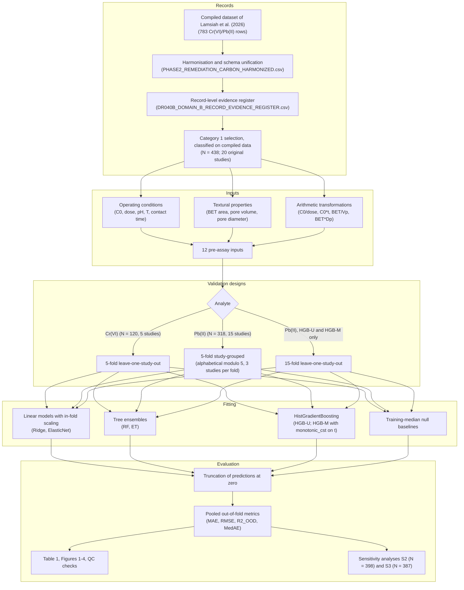

# Domain B Adsorption ML: Research Workflow

This document outlines the computational workflow of the Domain B evaluation of time-resolved Cr(VI) and Pb(II) uptake on activated carbons.

---

## 1. Workflow

---

## 2. Methodological principles

### 2.1 Study-aware validation
Records of one experimental series share every input except contact time. Records of one study share adsorbent, laboratory and protocol. A split that placed records of the same study in both training and test sets would let the model draw on the study's own series and would give optimistic error estimates.

To avoid this:
1. **Study-grouped folds:** all records of a study are kept in the same fold.
2. **In-fold preprocessing:** the scaler for the linear models is fitted on the training records of each fold only.
3. **Training-median null:** in every fold, each test record is predicted with the median $q_t$ of that fold's training records. Models are compared with this null under the same folds.

How much random row-wise splitting would inflate performance on these data was not measured.

### 2.2 Monotonic constraint on contact time
- **What HGB-M does:** it applies `monotonic_cst=[1, 0, ..., 0]`. This guarantees only that the fitted function does not decrease when contact time increases **and all other inputs are held fixed**.
- **Why trajectories are not guaranteed:** along a real batch experiment, the input $C_0 t$ also changes with time and is unconstrained. The predicted uptake curve of an experiment is therefore **not guaranteed** to be non-decreasing.
- **Status:** whether the fitted trajectories are in fact non-decreasing was not tested.
- **Effect on accuracy:** in the primary population, the constraint produced no appreciable change in accuracy (at most 0.075 mg/g in MAE; single seed, no significance test).
