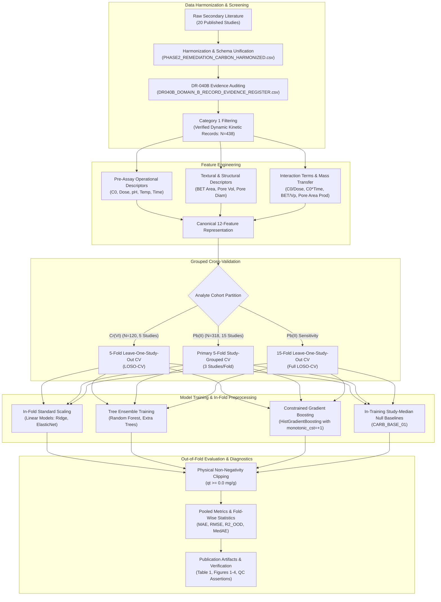

# Domain B Adsorption ML: Research Workflow and Methodology

This document outlines the end-to-end computational and empirical workflow governing the Domain B machine-learning evaluation for dynamic heavy-metal adsorption onto activated carbons.

---

## 1. End-to-End Workflow Architecture

---

## 2. Key Methodological Principles

### 2.1 Anti-Leakage Guarantee
In batch adsorption studies, dynamic kinetic data points from the same experimental run or literature study share identical adsorbent preparation methods, precursor chemistry, activation temperatures, and laboratory instrumentation. Standard random k-fold cross-validation results in severe data leakage, inflating test scores artificially because samples from the same isotherm or trajectory appear in both training and test sets.

To eliminate this vulnerability:
1. **Study-Grouped CV:** All data points from any individual published study are strictly confined to either the training split or the test split—never both.
2. **In-Fold Preprocessing:** Standard scalers and transformers calculate sample statistics strictly on the in-fold training subset.
3. **Out-of-Distribution Null Benchmark:** Every candidate model is evaluated against the held-out study-median baseline (CARB_BASE_01) to verify whether the model outperforms the simple empirical median of known historical studies.

### 2.2 Physical Constraint Enforcement
Under constant batch operating conditions with non-desorbing activated carbons, cumulative metal uptake ($q_t$, mg/g) is monotonically non-decreasing over contact time:
$$\frac{\partial q_t}{\partial t} \ge 0$$

Unconstrained non-linear estimators (e.g. standard gradient boosting or deep neural networks) can produce non-physical transient dips in predicted uptake over time. We enforce monotonicity directly during tree construction using histogram-based gradient boosting (`monotonic_cst=[+1, 0, ..., 0]`), guaranteeing thermodynamically sound adsorption curves.
